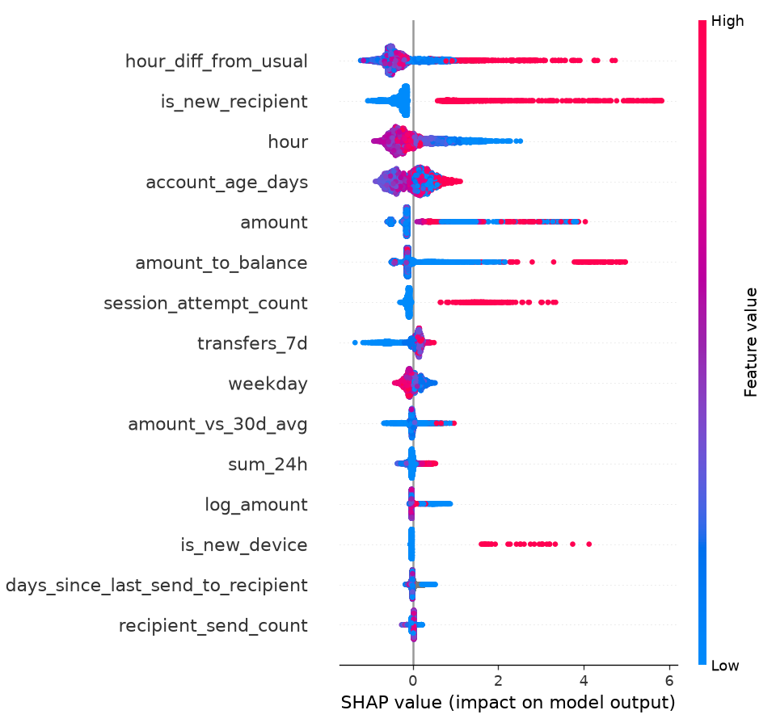

# FDS 모델 평가 결과

`fds_training/train.py`가 자동으로 쓰는 파일입니다. 다시 학습하면 덮어씁니다.

## 데이터

| 구분 | 기간 | 거래 | 사기 |
|---|---|---|---|
| 학습 | 2026-07-01 ~ 08-17 | 7,725 | 124 |
| early stopping | 2026-08-18 ~ 08-31 | 1,831 | 27 |
| 검증 | 2026-09 | 4,889 | 60 |

합성 데이터(`generate_data.py`, seed 42)이며 실제 사기 데이터가 아닙니다. 수치는 시나리오 설계에 따라 크게 달라집니다.

## 모델 지표 (검증 데이터)

| 지표 | 값 |
|---|---|
| PR-AUC (주 지표) | 0.9858 |
| ROC-AUC | 0.9998 |
| 재현율 80%에서의 정밀도 | 0.9818 |
| 트리 수 (early stopping) | 203 |

## 임계값

- 초기값: LOW < 0.3 ≤ MEDIUM < 0.7 ≤ HIGH
- 조정값: MEDIUM ≥ **0.9332** (검증 사기 재현율 90% 이상이 되는 가장 큰 값), HIGH ≥ **0.9712** (정밀도 90% 이상이 되는 가장 작은 값)
- **서비스는 초기값을 씁니다** (`model/thresholds.json`의 `medium`, `high`). 조정값은 `scale_pos_weight` 때문에 점수가 0·1 쪽으로 몰려
  MEDIUM 구간이 거의 사라지고, 같은 검증 데이터(사기 60건)로 고른 값이라 과적합 위험이 큽니다. 아래 표처럼 초기값과 차이도 작습니다.
- 합성 데이터라 점수가 실제보다 훨씬 잘 나옵니다. 모델이 놓치는 경우를 대비해 규칙 엔진이 1차 방어를 맡습니다 (MEDIUM 규칙 3개 이상이면 HIGH).

| | 사기 탐지(MEDIUM 이상) | 사기 차단(HIGH) | 놓친 사기 금액 | 정상 거래 추가 인증(오탐) | 정상 거래 차단(오탐) |
|---|---|---|---|---|---|
| 초기값 (0.3 / 0.7) | 59 / 60건 | 57건 | 10,000원 | 13 / 4,829건 | 5건 |
| 조정값 (0.9332 / 0.9712) | 53 / 60건 | 53건 | 20,275,000원 | 0 / 4,829건 | 1건 |

## 시나리오별 탐지 (조정 임계값 기준)

| | 건수 | MEDIUM 이상 | HIGH | 점수 중앙값 |
|---|---|---|---|---|
| account_takeover | 20 | 20 | 20 | 1.000 |
| test_then_large | 24 | 19 | 19 | 0.999 |
| voice_phishing | 16 | 14 | 14 | 1.000 |

## 규칙 엔진과 비교

규칙은 피처 컬럼으로 근사했습니다 (1회·1일 한도, 차단 후 재시도 규칙은 합성 데이터에 없음).

| | 사기 탐지 | 정상 오탐 |
|---|---|---|
| 규칙만 (MEDIUM 규칙 1개 이상) | 54 / 60 | 58 / 4,829 |
| ML만 (점수 ≥ 0.9332) | 53 / 60 | 1 / 4,829 |
| 규칙 + ML (둘 중 하나) | 57 / 60 | 58 / 4,829 |

## 피처 중요도 (평균 |SHAP|)

| 피처 | 설명 | 평균 \|SHAP\| |
|---|---|---|
| `hour_diff_from_usual` | 평소와 다른 시간대 | 0.533 |
| `is_new_recipient` | 처음 보내는 계좌 | 0.501 |
| `hour` | 이체 시간대 | 0.434 |
| `account_age_days` | 가입 후 경과일 | 0.343 |
| `amount` | 이체 금액 | 0.326 |
| `amount_to_balance` | 잔액 대비 이체 비율 | 0.251 |
| `session_attempt_count` | 대화 중 이체 시도 횟수 | 0.183 |
| `transfers_7d` | 최근 7일 이체 횟수 | 0.179 |
| `weekday` | 요일 | 0.125 |
| `amount_vs_30d_avg` | 평소 대비 이체 금액 | 0.073 |
| `sum_24h` | 최근 24시간 이체 합계 | 0.068 |
| `log_amount` | 이체 금액 | 0.057 |

## 해석할 때 주의할 점

- `weekday`(요일)가 상위에 있지만 생성기는 요일별 차이를 만들지 않았습니다. 사기 표본이 적어서 생긴 우연한 패턴(과적합)으로 봅니다.
- `session_attempt_count`는 생성기에서 사기 시나리오에 일부러 높게 넣은 값이라 중요도가 높게 나옵니다. 실제 데이터에서는 달라질 수 있습니다.
